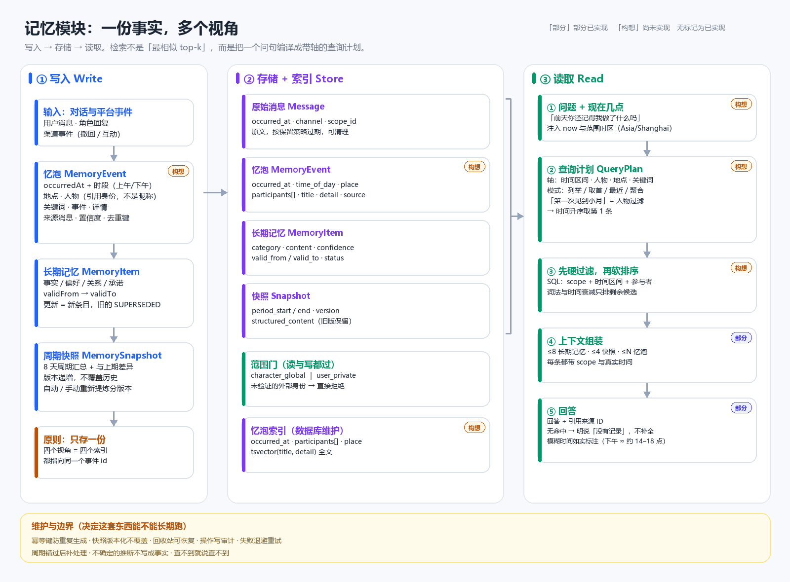

# 忆泡：事件记忆层设计构想（未实现）

> **状态：设计构想，尚未实现。** 本文描述目标形态、取舍依据和与现状的差距，不代表任何已上线行为。
> 当前实现边界以 [记忆系统与周期快照规则](memory-system.md) 为准；数据结构以 [数据模型设计](data-model.md) 和 `prisma/schema.prisma` 为准。
> 相关阅读：[B站渠道与记忆的接入](bili-desk-integration.md)、[公共世界与事件记忆设计构想](公共世界与事件记忆设计构想.md)（备选方案，当前不做，但它说明了忆泡为什么是公共世界的前提）。

## 1. 要解决的问题

现在这套记忆能回答“你还记得我喜欢什么”，但答不好下面三类问题：

1. **时间点查**：「前天（2026-10-25）你还记得我做了什么吗」
2. **首次 / 最近**：「你第一次见到小月是什么时候」
3. **场景召回**：「那天在海边说的那个计划后来怎么样了」

原因有三条，彼此独立，不能靠调提示词一次性解决：

- 长期记忆只有自由文本 `content`，没有“事件发生时间”字段，模型手里没有日期可答；
- 提示词里没有“现在几点”，`前天` 无法被解析成具体日期；
- 人物只是文本里的一串字，没有实体，既不能按人过滤，也无法区分同名。

## 2. 忆泡是什么

一条忆泡（事件记忆记录）是“一次发生了什么”的最小完整记录，对应 Graphiti 里 episode 的角色。

| 字段 | 类型建议 | 说明 |
| --- | --- | --- |
| `occurredAt` | `timestamptz` | 事件**发生**时间（不是入库时间），按 UTC 存储 |
| `occurredEndAt` | `timestamptz?` | 可选结束时间，用于“聊了两小时”这类时长 |
| `timeOfDay` | `enum` | 清晨 / 上午 / 中午 / 下午 / 傍晚 / 晚上 / 深夜 |
| `precision` | `enum` | `exact` / `part_of_day` / `day`，标明时间精度 |
| `place` | `varchar?` | 自由文本地点，不做地理编码，不引入坐标或地图依赖 |
| `participants` | 关系表 | 引用 `userId` / `externalIdentityId`，不是昵称字符串 |
| `title` | `varchar` | 一句话事件，例如“和小关在北海银滩游泳” |
| `keywords` | `varchar[]` | 3–5 个同义或相关词，供词法检索扩展 |
| `detail` | `text` | 详细经过，可保留原始表述 |
| `sourceMessageId` | `uuid?` | 来源消息；必须能追溯，不接受无来源的模型推断 |
| `sourceSnapshotId` | `uuid?` | 由快照提炼时的来源 |
| `confidence` | `float?` | 模型抽取置信度；低置信度只作候选，不写成确定事实 |
| `memoryScopeId` | `uuid` | 复用现有范围隔离，不另立一套权限 |
| `dedupeKey` | `varchar?` | 幂等键，防止周期重跑或任务重试重复生成 |

### 2.1 四条规则

1. **时间有两种，不能混。** 记录时间（`createdAt`）和事件发生时间（`occurredAt`）必须分开。用户问“那天”指的是后者。
2. **模糊是信息，不是缺陷。** “下午”不等于某个时间点。用 `timeOfDay` + `precision` 如实表达，不要为了排序把“下午”伪造成 14:00。这也是模型回答时唯一诚实的做法。
3. **人物是引用，不是字符串。** 昵称只用于显示和别名解析。未经绑定的跨平台身份不得合并（见 `CLAUDE.md` 第 4 条）。
4. **忆泡只追加，不覆盖。** 事件一旦发生就不会变。后来的变化体现为新增忆泡或新增长期记忆，而不是改写旧记录。

## 3. 与现有三层的关系

| 层 | 回答什么问题 | 能否被覆盖 | 生命周期 |
| --- | --- | --- | --- |
| 原始消息 `Message` | “原话是怎么说的” | 否 | 按保留策略过期清理 |
| **忆泡 `MemoryEvent`** | **“那天发生了什么”** | **否，只追加** | 长期保留，可压缩归档 |
| 长期记忆 `MemoryItem` | “他是什么样的人” | 是，新条目替代旧条目 | 状态机（ACTIVE / SUPERSEDED / INVALIDATED / TRASHED） |
| 周期快照 `MemorySnapshot` | “那段时间整体如何” | 新版本，不覆盖旧版 | 8 天周期，版本递增 |

### 3.1 为什么不把忆泡写进 `MemoryItem.content`

1. 长期记忆会被 `SUPERSEDED` 或 `INVALIDATED` 覆盖，“第一次见面”这种事实不该跟着后续总结一起变；
2. 文本里塞日期就无法按时间区间过滤，只能做正则，时区和边界全乱；
3. 删除语义会打架：删一条记忆到底等于删掉一段事实，还是一次结论？

分层之后，“事实”和“结论”各有各的生命周期，删除与改写互不牵连。

图中标记为「构想」的模块尚未实现，「部分」表示只实现了一部分（例如上下文装配的条数上限已经生效，忆泡还没有）；没有标记的是当前已有能力。读取侧的长括号表示读取会访问上面全部四层，不是只看忆泡一层。

## 4. 存储：一份事实，多份索引

**原则：正排只存一份，四个视角（时间 / 地点 / 人物 / 关键词）都是指向 `id` 的索引。**

- 不要把整条事件复制到每个视角下。复制的是索引指针，不是正文。
- 写入只有一个入口，保证“改地点只改一处”。多处副本最大的代价不是空间，而是改一处忘三处导致的不一致。
- 派生字段（`keywords`、用于展示的整句）由生成流程产出，或标记为只读的原始来源文本，不允许两边各自编辑。

建议索引（尚未落地，仅作设计目标）：

- `(memoryScopeId, occurredAt)`：时间轴列举与区间查询；
- `(memoryScopeId, status, occurredAt)`：过滤归档与回收站；
- 参与者关系表上的 `(participantId, occurredAt)`：按人检索；
- `tsvector(title, detail)` 全文索引：关键词与模糊描述。

这些由数据库维护即可，不需要在应用层手写副本。数据量小时可先只建前两个。

## 5. 检索：把问题编译成查询计划

检索不是“找最相似的几条”，而是先把问句编译成“轴 + 模式”，再做过滤与排序。

| 问法 | 模式 | 主要轴 |
| --- | --- | --- |
| 前天我做了什么 | 列举（时间升序） | 时间区间 |
| 第一次见到小月是什么时候 | 取首（时间升序取第 1 条） | 参与者 |
| 我和小月最近聊了什么 | 最近（时间倒序） | 参与者 + 时间 |
| 小月喜欢什么 | 聚合（读长期记忆，不是忆泡） | 参与者 + 类别 |
| 那天在海边说的那个计划 | 列举 + 关键词 | 时间区间 + 关键词 |

流程固定为三步：

1. **硬过滤**：范围白名单 + 时间区间 + 参与者 + 地点，全部走索引；
2. **软排序**：词法匹配、时间衰减、访问强化，只作用于剩余候选；
3. **上下文组装**：按固定上限拼装，超出部分丢弃，不做二次检索。

**“先搜人物再搜日期”和“先搜日期再搜人物”是同一个查询**，条件之间可交换；顺序不影响结果，只在候选为空时按既定顺序放宽一个条件。

### 5.1 服务端负责时间，模型不做日期算术

- 解析“前天”“上周三”“2026-10-25”，按范围时区（默认 `Asia/Shanghai`）换算成 `[start, end)`；
- 把事件时间渲染成“10 月 25 日下午”再交给模型；
- 提示词必须包含“现在是什么时间”，否则相对日期无法落地。

模型只负责组织语言，不负责推算日期——这既省 token，也少一类事实性错误。

### 5.2 一次回复的固定预算

| 项 | 上限 |
| --- | --- |
| 记忆查询 | 2–3 条带索引的查询 |
| 忆泡 | ≤ 10 条 |
| 长期记忆 | ≤ 12 条 |
| 快照 | ≤ 2 份 |
| 记忆区 token | ≤ 1800 |
| 生成阶段的额外模型调用 | 0 次 |

上限不随记忆总量增长：一万条和十万条，模型看到的量一样。压力落在数据库索引上，而不是模型上下文里。

### 5.3 空结果规则

查不到时不重试、不放宽成“也许”，直接回答记不清，并说明大概是哪段时间没有记录。**重试是延迟和幻觉的主要来源**，收益通常只是让回答更自信而不是更准确。

## 6. 范围与身份

- 读写都经过现有 `resolveChatMemoryScopes()` 白名单：`character_global` 始终可读，`user_private` 仅限当前用户，未验证外部身份一律拒绝。
- 忆泡挂在 `memoryScopeId` 下，不新增一套权限模型。
- 提示词里只出现 `character` / `private` 语义标签，不发送范围 ID、用户 ID 或 `scopeKey`。
- 参与者引用身份，昵称仅作显示；没有别名表之前，按昵称匹配只能作为关键词降级路径，并明确标注不确定。

## 7. 遗忘

遗忘不等于删除。人脑的遗忘主要是取不出来，而不是痕迹被擦掉；直接 `DELETE` 会把“想不起来”变成“从来没发生过”，对角色扮演是完全不同的效果。

分三层处理：

1. **存储层删除**（真删）：只对原始消息（按保留期）、用户主动删除、以及低置信度且已被快照完全覆盖的内容。
2. **检索层降权**（主要手段）：排序分乘 `exp(-Δt/τ)`，`τ` 按类别给不同值——承诺与关系偏大（记得久），闲聊偏小（很快模糊）；被检索到并被引用的条目加权，“越常提越清晰”。
3. **压缩**：快照生成时把同主题的多条忆泡合并成一句阶段摘要，原始忆泡降级归档，不删除。

## 8. 规模与成本

按“日常聊天 + 每天刷几轮 B站”的量级估算：

| 来源 | 每天 | 一年 |
| --- | --- | --- |
| 聊天消息 | 几十到两百条 | 几万条 |
| 由聊天抽出的忆泡 | 10–30 条 | 约 1 万条 |
| B站判重记录 | 10–20 条 | 约 5 千条 |
| B站每轮报告 | 1–3 条 | 约 1 千条 |

结论：**单表加索引足够**，查询在毫秒级。这个规模不需要图数据库、独立向量服务或消息队列。

同义召回先用便宜的办法解决：生成忆泡时顺便产出 3–5 个同义关键词，检索时一并匹配。只有在真实数据证明关键词扩展仍经常漏召回时，才评估 `pgvector`。触发条件写清楚，避免提前上架构。

B站这一路已经有天然的事件流：`BiliSeenVideo`（`seenAt` / `result` / `reason`）接近忆泡，`BiliRoundReport` 接近会话级汇总。缺口不是存储，而是“聊天与 B站两路事件能否拼成一条时间线”。

## 9. 与当前实现的差距

| 能力 | 现状 | 缺口 | 涉及位置 |
| --- | --- | --- | --- |
| 事件层 | 无 | 新建 `MemoryEvent` 表 + 迁移 | `prisma/schema.prisma` |
| 当前时间注入 | ✅ 已实现（2026-10-31）：提示词每轮带 `now`（当地时间 / 星期 / 时区 / UTC） | 无 | `server/utils/chat-time-context.ts` |
| 事件时间进上下文 | 🟡 部分：长期记忆已带 `occurredAt`（`validFrom` ?? `createdAt`），快照本来有周期 | 忆泡本身还没有时间轴 | `server/api/characters/[id]/chat.post.ts` |
| 查询计划 | 无，纯词法排序 | 轴解析 + 硬过滤 + 模式 | `server/utils/memory-retrieval.ts` |
| 时间衰减 | ✅ 已实现（相关度 × 重要度 × 半衰期 × 召回加成，首条保底） | 无 | `server/utils/memory-retrieval.ts` |
| 参与者解析 | 无，无别名表 | 身份引用 + 别名降级 | 新增 |
| 空结果策略 | ✅ 已实现：提示词要求「没有记录就说没有，不许编日期或故事」 | 无（行为效果仍待真实对话验证） | `server/utils/chat-reply.ts` |
| 忆泡时间线 | 已有消息 / 记忆 / 快照条目 | 缺 `event` 类型的展示 | `server/utils/memory-timeline-dto.ts` |

## 10. 分阶段建议

每个阶段都能独立验收，且都不需要提前建全量架构。

**M1：让模型看得见时间（最小可见收益）—— 已完成（2026-10-31）**
- 已做：`server/utils/chat-time-context.ts` 渲染 `now`（当地日期时间 / 星期 / IANA 时区 / UTC），由 `CharacterMemorySetting.timezone` 决定，坏值回落 `Asia/Shanghai`；网页对话与 QQ 两条调用链都传；长期记忆带 `occurredAt`；系统提示词新增「按 `now.local` 解析相对日期」「没有记录就明说，不许编日期或故事」两条硬规则（提示词版本升到 v10）。
- 未做：忆泡本身的时间轴、按时间区间检索 —— 那是 M2。
- 测试：`yarn test:chat-reply` 覆盖时区换算（东八区 / 西五区 / 坏值回落）、`now` 字段、记忆 `occurredAt` 与提示词规则。

**M2：忆泡与查询计划 —— 已做一部分（2026-10-31）**
- 已做：
  - `MemoryEvent` 表 + 迁移（`20261031160000_memory_events`）：`occurredAt` / `timeOfDay` / `precision` / `place` / `title` / `detail` / `keywords[]` / `participants[]` / `confidence` / 来源消息与快照 / `dedupeKey`，索引 `(scope, occurredAt)`。
  - 抽取：周期快照的同一次模型调用顺带产出 `events`，校验（时间可解析、有标题/详情、有来源消息）后与快照同事务落库；重新提炼不写忆泡。
  - **按天整理**：调度器每天为「昨天」排 `EXTRACT_EVENTS` 任务（幂等键 `daily-events:{scopeId}:{YYYY-MM-DD}`，当天没有对话就不排，跟随 `autoSnapshotEnabled` 开关），worker 只写忆泡、不写快照与长期记忆；模型未配置时留在队列重试。
  - 检索：`parseEventTimeRange()` 把「今天/昨天/前天/N 天前/上周三/本周三/2026-10-25/10月25日 + 上午·下午·晚上」解析成区间；`selectEventsForPrompt()` 先按区间列时间线，框不住才退化成关键词；单独预算 800 token、上限 8 条，首条保底。
  - **原文兜底**：忆泡有小时级延迟，超过最近对话窗口的部分按同一时间区间查原始消息（`message-retrieval.ts`，预算 900 / 6 条，已进窗口的不重复）；原文只当证据，冲突时以忆泡为准。
  - 注入：网页对话与 QQ 两条链都带上 `events`（含 `occurredAt` / `timeOfDay` / `place` / `participants` / scope），提示词说明「按时间顺序列举，没有记录就明说」（提示词版本 v11）。
- 未做：
  - **参与者硬过滤**（「小月那次」还不能按人筛，`participants` 只是显示名）；
  - **取首/聚合模式**（「第一次见面」仍答不了，需要 `ORDER BY occurredAt ASC LIMIT 1` 这类查询形态）；
  - 忆泡时间线 UI 与 B站记录并入；
  - 忆泡引用的来源 ID 还没有回写到消息的 `usedSources`。
- 测试：`yarn test:memory-events`（日期解析、时段收窄、周起点、空区间、关键词回退、预算保底、幂等键）与 `yarn test:chat-reply`（`events` 字段进提示词）。

**M3：遗忘与展示**
- 时间衰减与访问强化；快照压缩；时间线加入忆泡条目；B站记录并入同一时间线。
- 验收：同一条数据在“降权”后仍可回溯，不出现数据丢失。

## 11. 明确不做

- 不引入图数据库与图遍历；
- 不引入独立向量库或 embedding 服务；
- 不做多跳 agentic 检索与反思循环（一次回复多次模型调用）；
- 不因昵称相同合并跨平台身份；
- 不对忆泡做自动硬删除，只做压缩归档与降权。

## 12. 开放问题

1. 什么算“值得记的事件”：B站每条看过的视频都进忆泡，还是只记挑中的？
2. 时段粒度（上午 / 下午）够不够，是否需要具体时刻？
3. 忆泡与长期记忆的边界：“小月喜欢深烘咖啡”是事件还是结论？由哪一层产出？
4. 是否需要用户可见的忆泡纠错入口（现有记忆时间线可以扩展）？
5. 参与者别名表什么时候引入，先用“已知用户 + 昵称字符串”过渡是否可接受？
